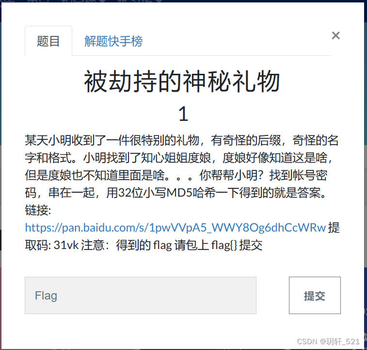
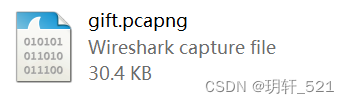
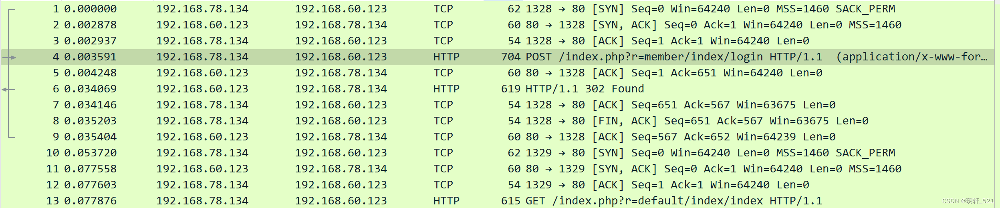
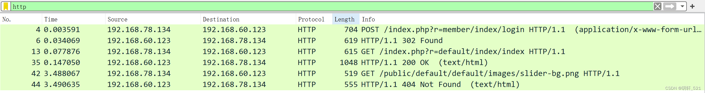
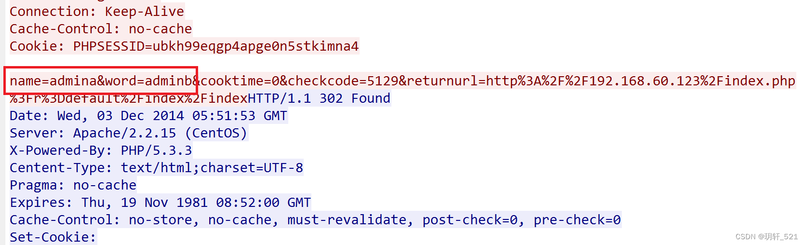
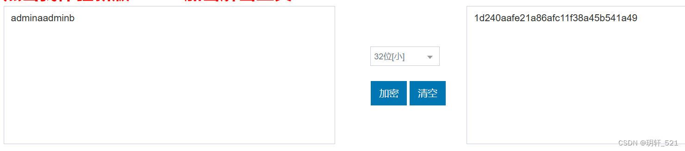

**BUUCTF: [https://buuoj.cn/challenges](https://buuoj.cn/challenges)** 

---

相关阅读

- [CTF Wiki](https://ctf-wiki.org/)


 

### 题目描述：

某天小明收到了一件很特别的礼物，有奇怪的后缀，奇怪的名字和格式。小明找到了知心姐姐度娘，度娘好像知道这是啥，但是度娘也不知道里面是啥。。。你帮帮小明？找到帐号密码，串在一起，用32位小写MD5哈希一下得到的就是答案。 链接: [https://pan.baidu.com/s/1pwVVpA5_WWY8Og6dhCcWRw](https://pan.baidu.com/s/1pwVVpA5_WWY8Og6dhCcWRw) 提取码: 31vk

### 密文：

下载附件，得到一个名为gift.pcapng的wireshark流量包。



---

### 解题思路：

1、双击gift.pcapng文件，进入Wireshark中。



题目要求找到帐号密码，我们先将HTTP流量过滤出来看一下。
 

看到一个POST方法和两个GET方法，直奔POST方法的那条流量，追踪它的HTTP流，找到账号和密码。



```bash
name=admina&word=adminb
```

2、将帐号密码串在一起，使用在线网站对字符串进行32位小写MD5哈希加密，得到flag值。
[MD5加密解密工具](https://www.sojson.com/md5/) 
 

### flag：

```bash
flag{1d240aafe21a86afc11f38a45b541a49}
```