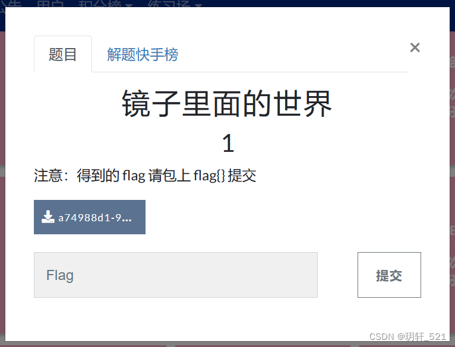
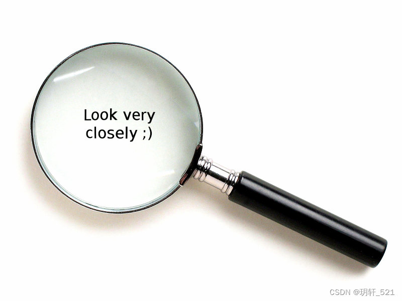
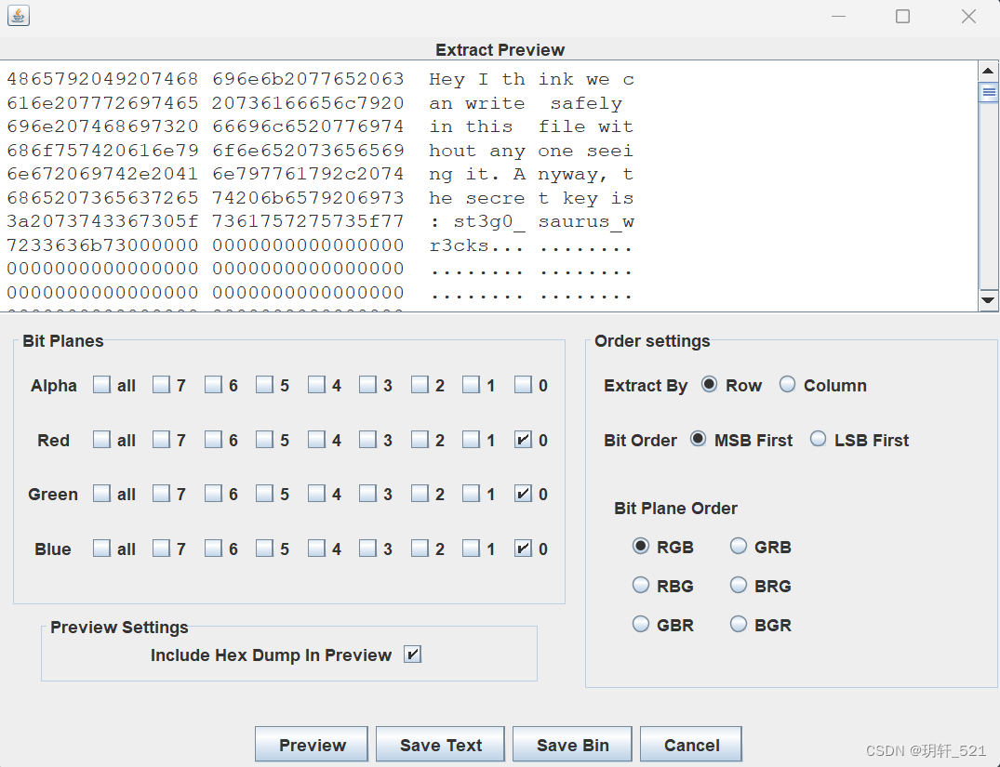
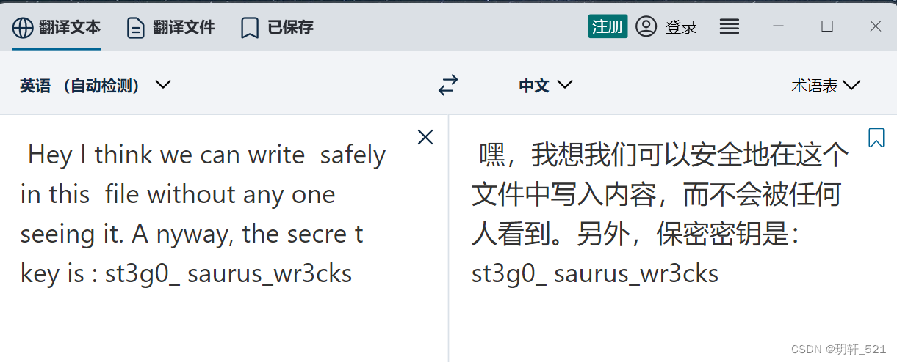

**BUUCTF: [https://buuoj.cn/challenges](https://buuoj.cn/challenges)** 

---

相关阅读

- [CTF Wiki](https://ctf-wiki.org/)




### 题目描述：

下载附件，解压得到一张.png图片。

### 密文：



### 解题思路：

1、材料只有一张图片，题目提示“镜子里面的世界”结合图片中的英文“look very closely”（翻译为“仔细观察”，暗示LSB隐写），认为是图片隐写中的LSB隐写。（其实，我是写出来后，才反推出他给出的线索是什么意思。）
[LSB例题，里面有LSB原理](https://blog.csdn.net/YueXuan_521/article/details/134053293?spm=1001.2014.3001.5502) 

2、将图片放到StegSolve中，然后打开Analyse（分析）选项卡，使用Data Extract（数据提取）选项，开始分析，得到提示信息。



3、将提示的信息翻译过来，就找到了flag。



### flag：

```bash
flag{st3g0_saurus_wr3cks}
```