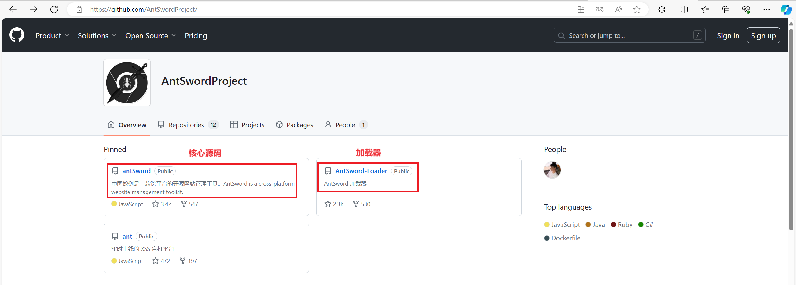
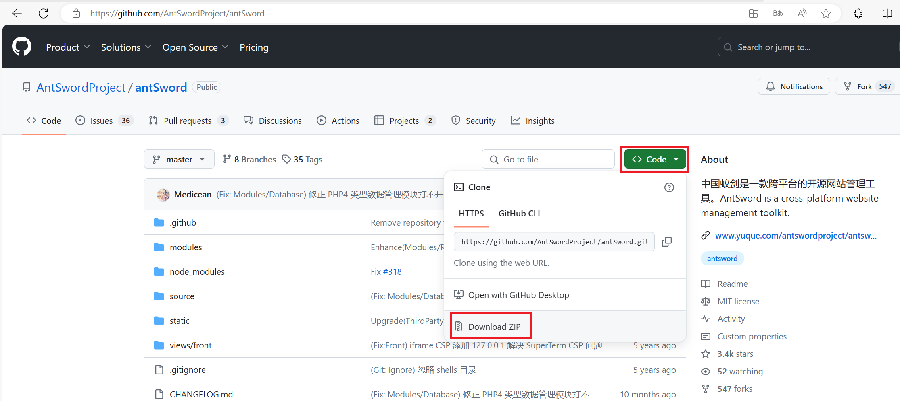
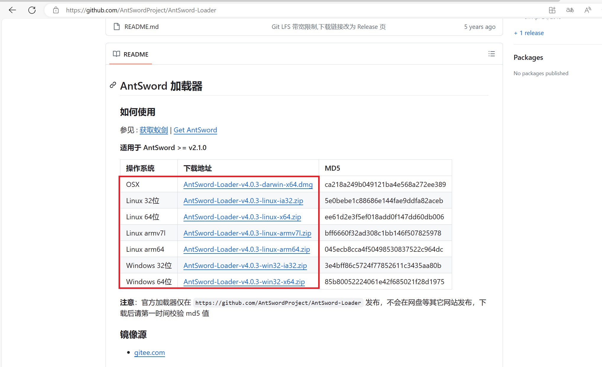
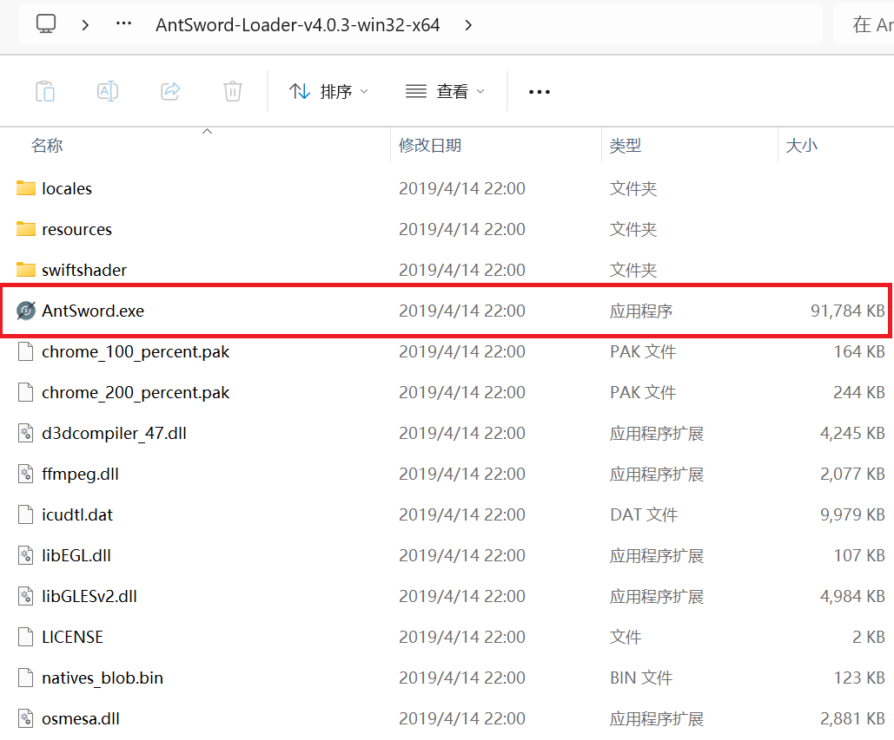
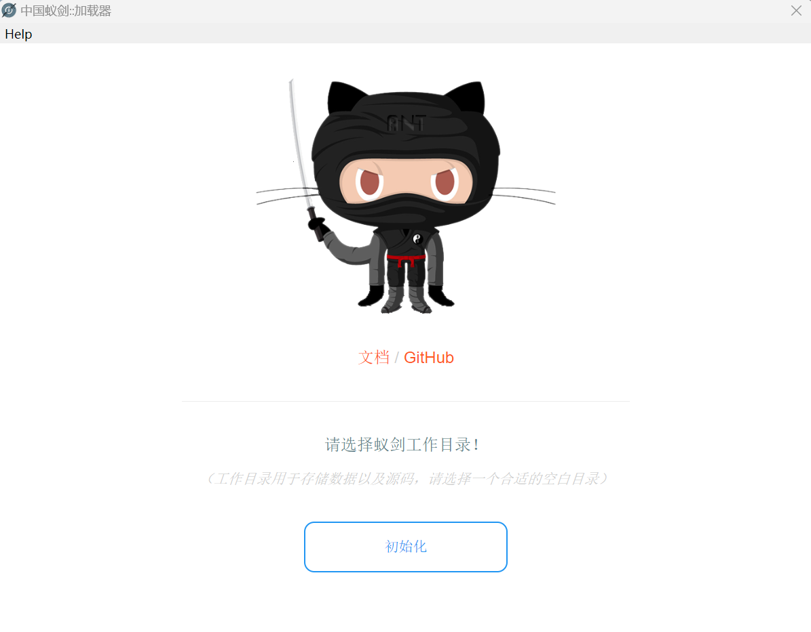
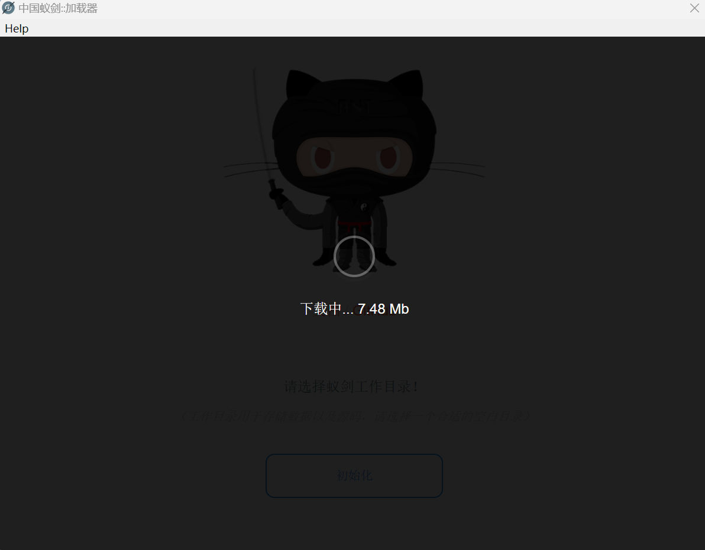
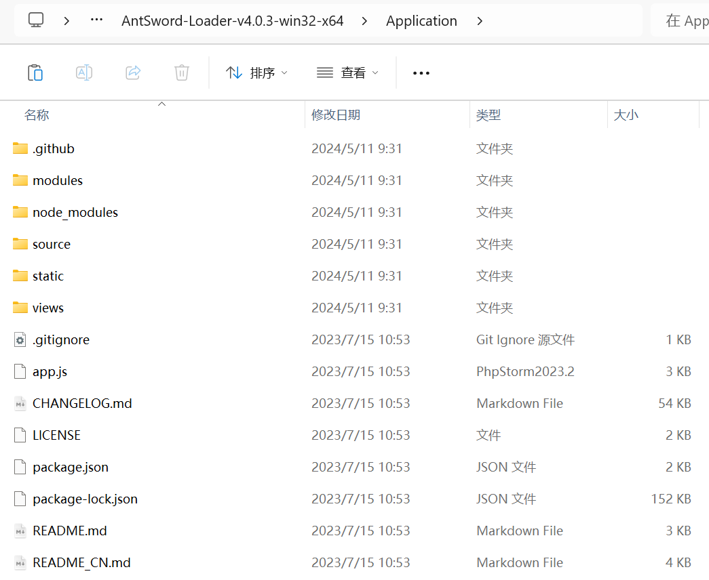
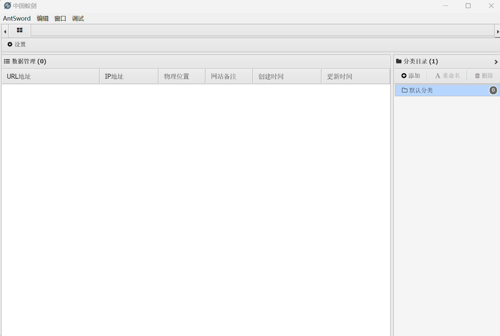
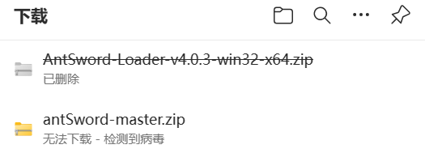
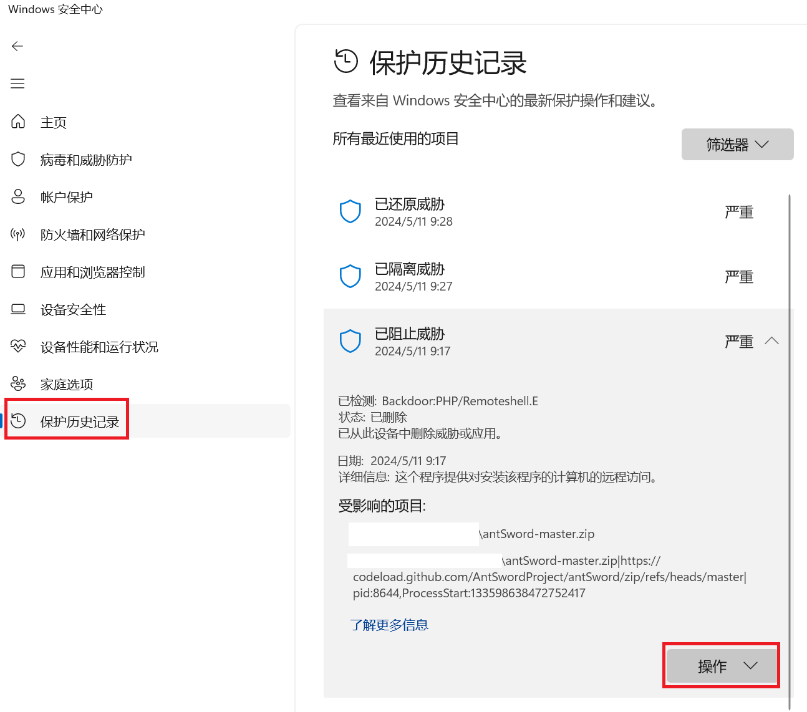

## 2024/5/11中国蚁剑安装教程

一、下载中国蚁剑的加载器和核心源码（两个都要用到）

github官方下载地址：https://github.com/AntSwordProject/

参考文档： [antSword/README_CN.md at master · AntSwordProject/antSword · GitHub](https://github.com/AntSwordProject/antSword/blob/master/README_CN.md) 

 

[核心源码下载：](https://github.com/AntSwordProject/antSword?tab=readme-ov-file) 

 

[加载器下载：](https://github.com/AntSwordProject/AntSword-Loader) 

 

二、在完成两个文件的下载后，进行解压缩。接下来，到名为“AntSword-Loader-v4.0.3-win32-x64”的加载器文件夹，然后启动该文件夹内的AntSword.exe应用程序。

 

加载器页面：

 

三、假如依照指示，用户选定一个空白目录来进行初始化操作，系统将自动执行源代码的下载任务。

 

不过，我们已经将源代码下载好了，选择源代码的文件夹路径。文件夹内如下所示：

 

初始化进程完毕后，系统会自动重新启动。再次开启程序时，即可直接开始使用。

 

小问题：

下载中国蚁剑的核心源码时，可能因为检测到病毒无法下载，或文件被防火墙删除。

 

前往“Windows防护中心”–>“保护历史记录”，选择“操作”中的“还原”，就可以解决问题。

 

